# M3-FIX-2 Pixel font legibility

Status: done

## What changed

- `src/ui/theme/tokens.css`: `--font-pixel` (headings, buttons, labels, names, HUD) is now
  `var(--font-body)`, which is Atkinson Hyperlegible. No CSS module changes. Every
  `font-family: var(--font-pixel)` now gets the legible font.
- `src/ui/theme/fonts.css`: comment only. Pixelify Sans stays registered, but only the Settings
  "Letters" preview uses it now. The browser fetches it only when that preview shows.
- `index.html`: preloads the two Atkinson faces in place of Pixelify, because the first screen
  now uses Atkinson. Pixelify isn't preloaded, so the browser won't warn about an unused preload.
- `src/a11y/page.ts`: comment only. It explains that the `pixel` setting now looks like `clean`.
- `tests/unit/ui/kit.test.tsx`: the tokens test now asserts that `--font-pixel` is
  `var(--font-body)` and that no font token names Pixelify.
- `docs/fonts.md`: role table, preload note and a new section with the M3-FIX-2 findings.
- `docs/handoffs/M3-FIX-2/`: glyph sheets, plus before and after screenshots.

## Glyph sheet

Every capital and digit, plus the words from the playtest, at the sizes the app uses: `--fs-sm`
16, `--fs-md` 20, `--fs-lg` 26 and `--fs-xl` 36 px, and the same at Sprout's 1.5× letter size
(24, 30, 39, 54 px). Pixelify Sans is shown at 400, 500, 600 and 700, and Atkinson Hyperlegible
at 400 and 700. The sheets were rendered in headless Edge (Chromium) at 1× from the repo's own
font files.

- [Pixelify Sans, 1× sizes](M3-FIX-2/glyphs-pixelify-1x.png)
- [Pixelify Sans, 1.5× sizes](M3-FIX-2/glyphs-pixelify-1.5x.png)
- [Atkinson Hyperlegible, both size sets](M3-FIX-2/glyphs-atkinson.png)

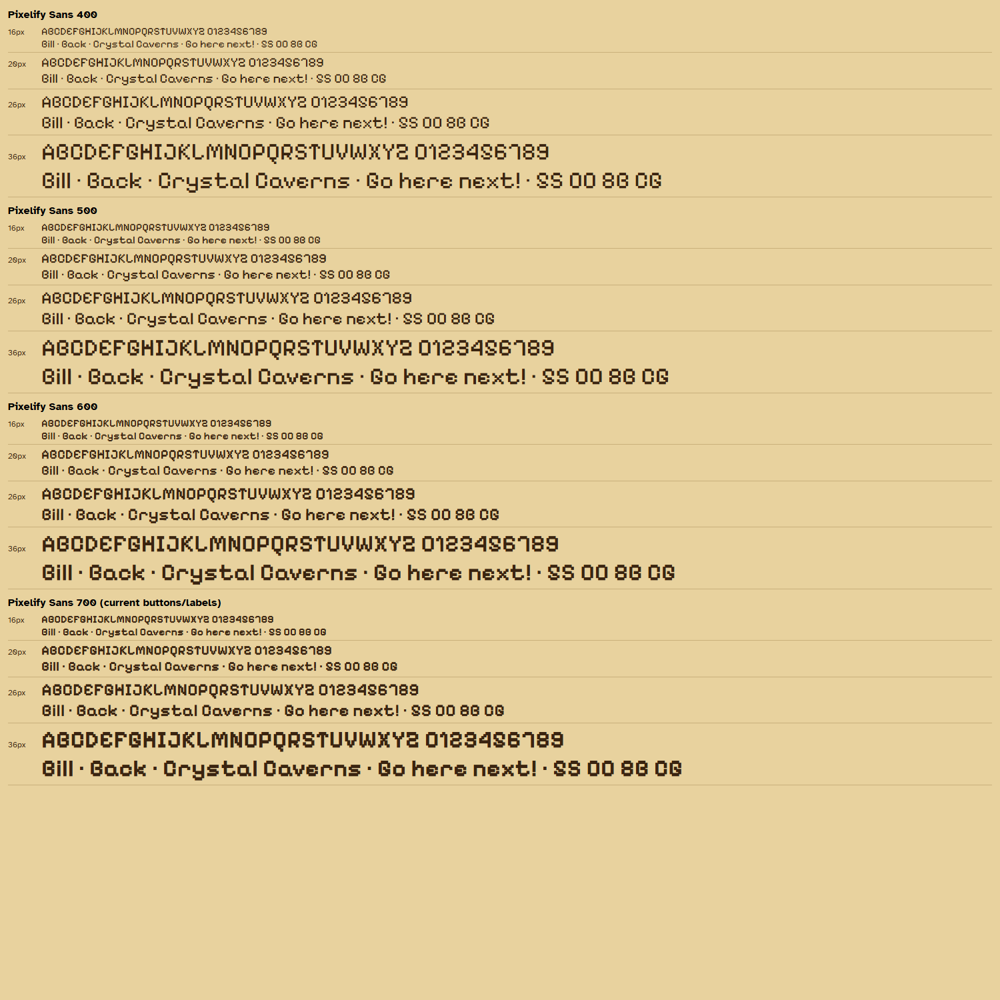

**My verdict on Pixelify Sans:** no weight and no size fixes it. The problem is the shape of the
letters, not their thickness:

| Glyph | What it looks like                        | Bad at                 |
| ----- | ----------------------------------------- | ---------------------- |
| `B`   | open top-left corner: reads as `G` or `8` | every weight, 16–54 px |
| `C`   | notch on the right: reads as `O`          | every weight, 16–54 px |
| `G`   | reads as `C` or `6`                       | every weight           |
| `5`   | the same shape as `S`                     | every weight, 16–54 px |
| `0`   | the same shape as `O` (no slash or dot)   | every weight, 16–54 px |
| `Z`   | the same shape as `2`                     | every weight           |
| `J`   | reads as `D` or `U`                       | every weight           |
| `8`   | close to `B`                              | 600 and 700            |

The lighter weights (400, 500) are a little less muddy at 16 px, but `B`, `C`, `5` and `0` are
just as ambiguous. At 54 px "Crystal Caverns" still reads as "Orystal Oaverns" and "Back" as
"Gack". The big titles fail too, so following the card I moved them as well. The only blocky
lettering left is the Splash logo, which is drawn as SVG voxel letters (M2-11), not set in
Pixelify, so it keeps its look.

**Atkinson Hyperlegible:** every capital and digit is distinct at every size and weight. `0` has
a slashed counter, `B` and `8` differ clearly, and so do `5` and `S`, `C` and `O`, `Z` and `2`.

## Before and after

The before images are the baselines on `main`. The after images are the baselines that CI made
for this branch with the Update snapshots workflow.

| Screen                                                     | Before (Pixelify)                              | After (Atkinson)                             |
| ---------------------------------------------------------- | ---------------------------------------------- | -------------------------------------------- |
| Profiles ("Bill" → "Gill", "Back" → "Gack")                | 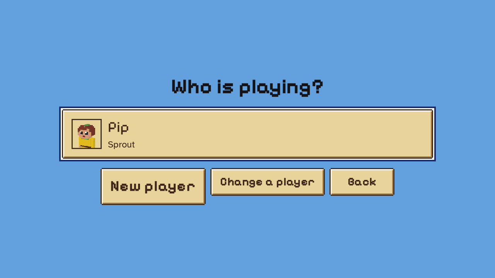  | 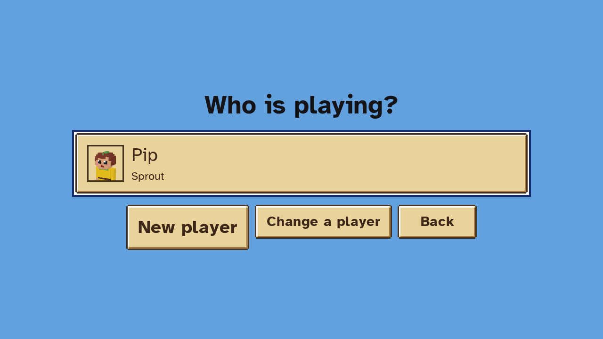  |
| World map, new player ("Go here next!", "Crystal Caverns") | 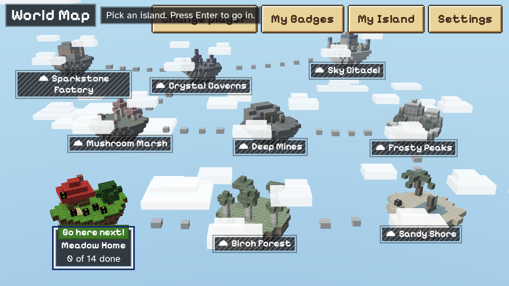  | 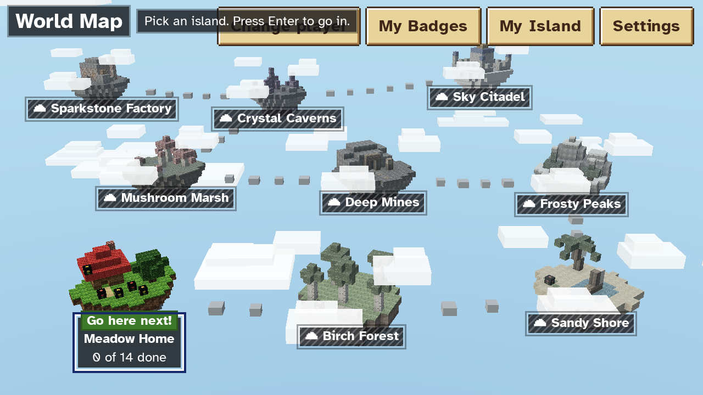  |
| World map, all islands open                                | 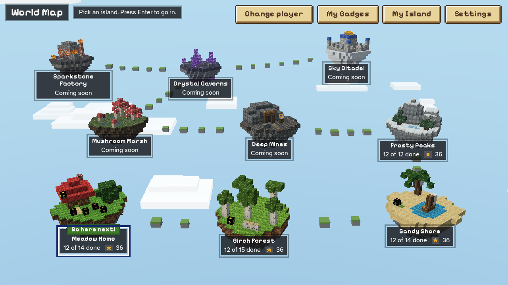    | 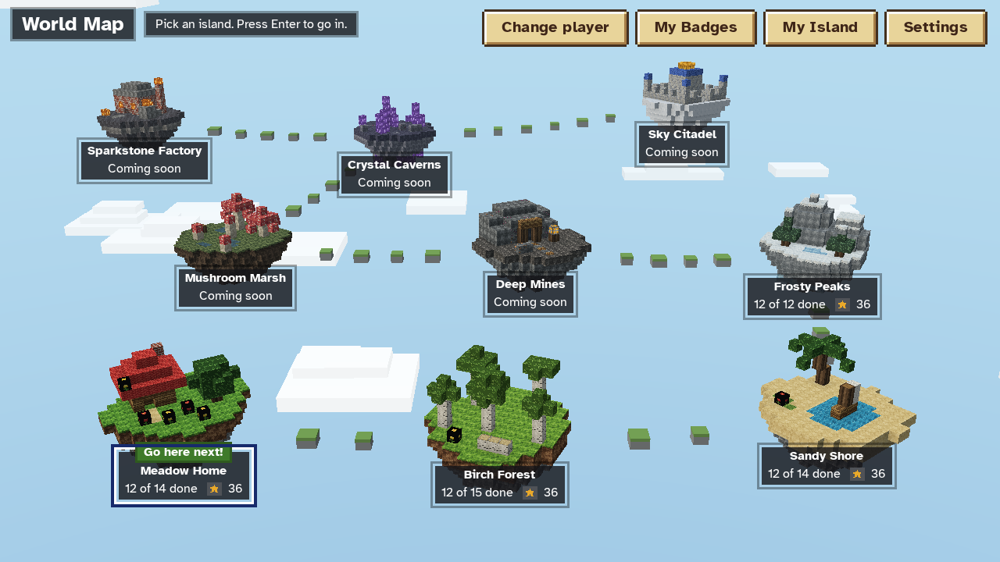    |
| Results                                                    | 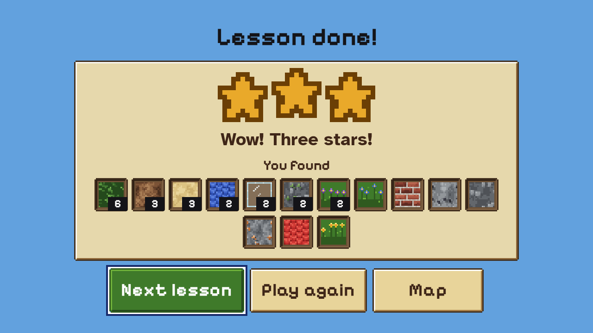         |          |
| Splash (only the button changed; the logo is SVG)          | 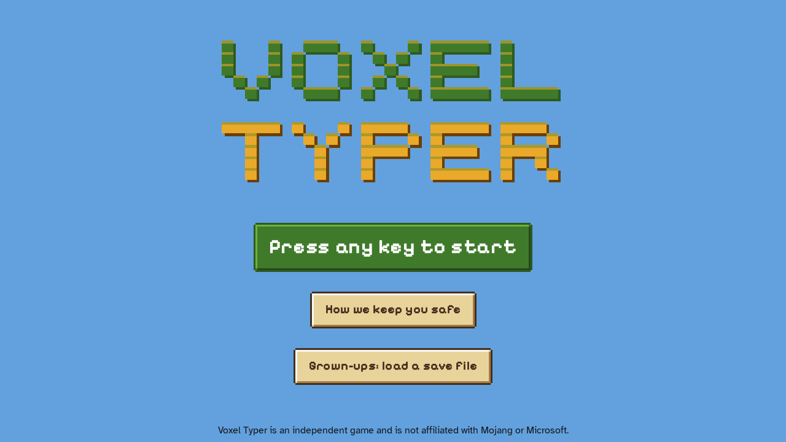          | 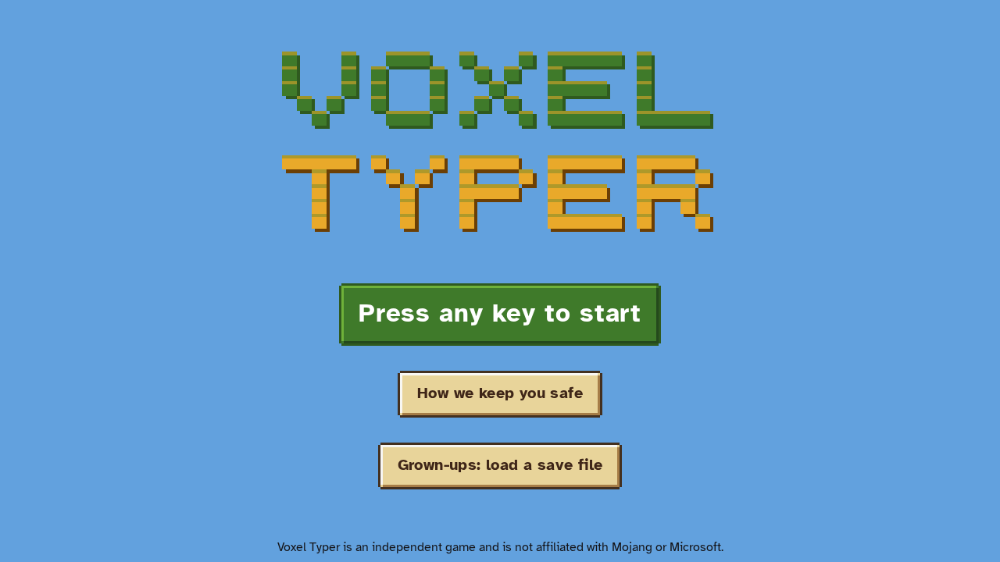          |
| UI kit, day                                                | 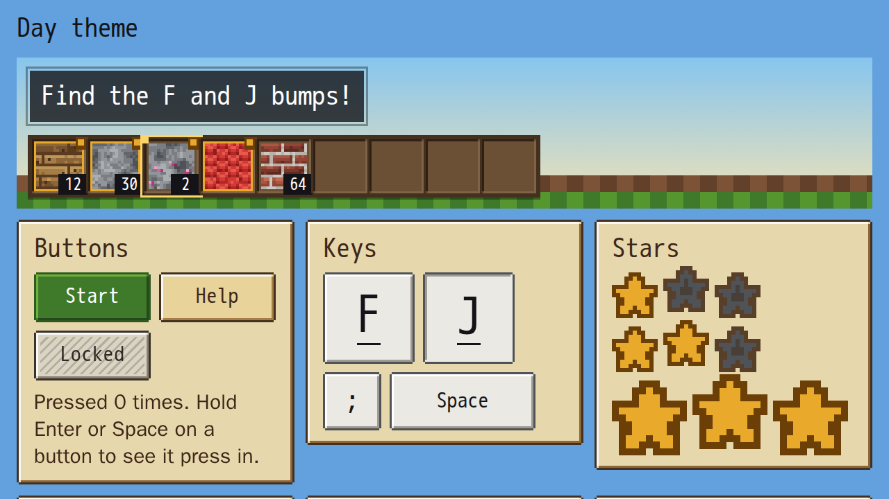      | 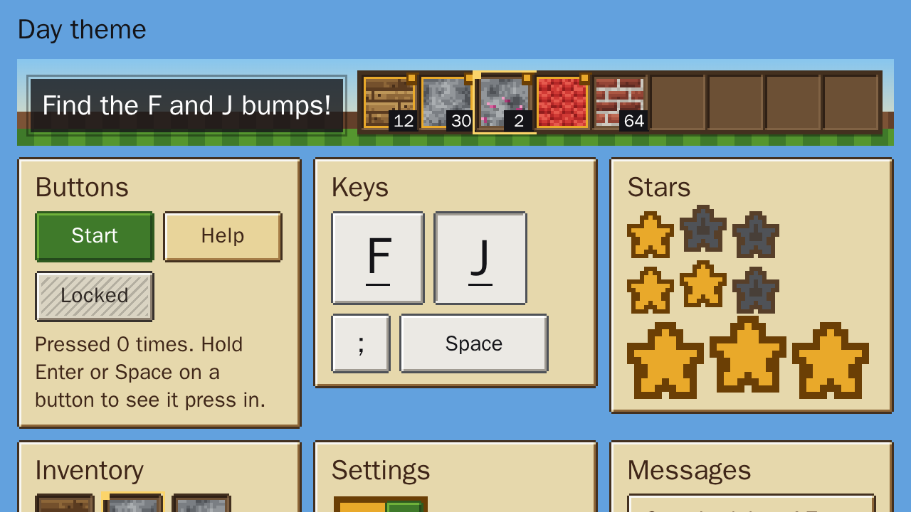      |
| UI kit, night                                              | 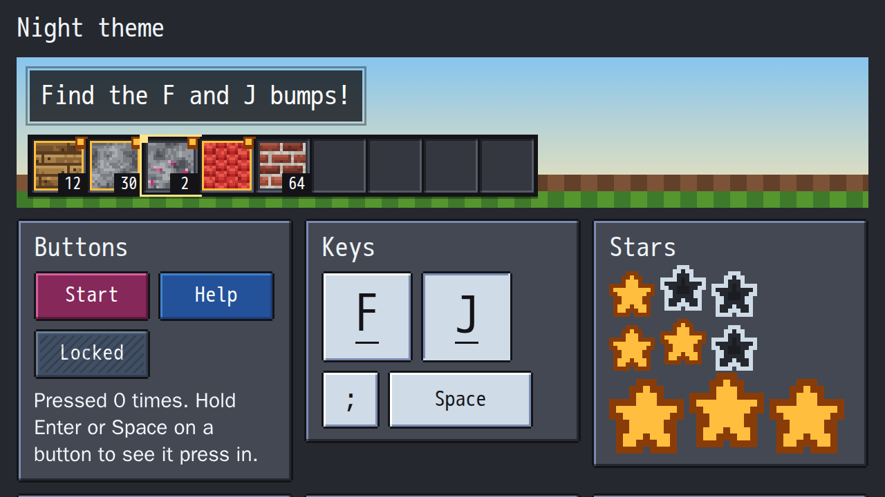    | 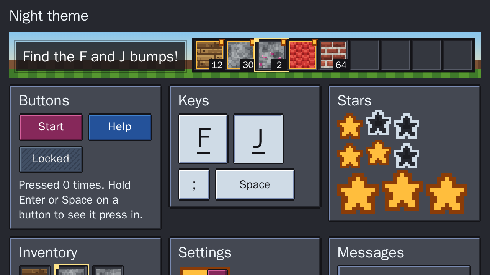    |
| UI kit, high contrast                                      | 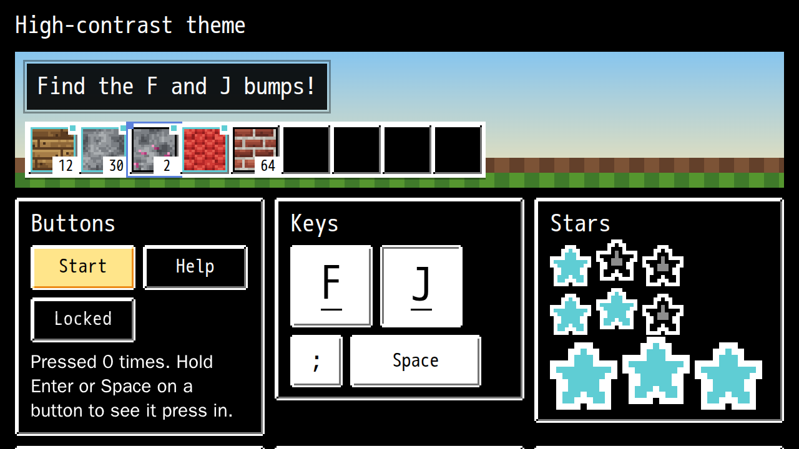 | 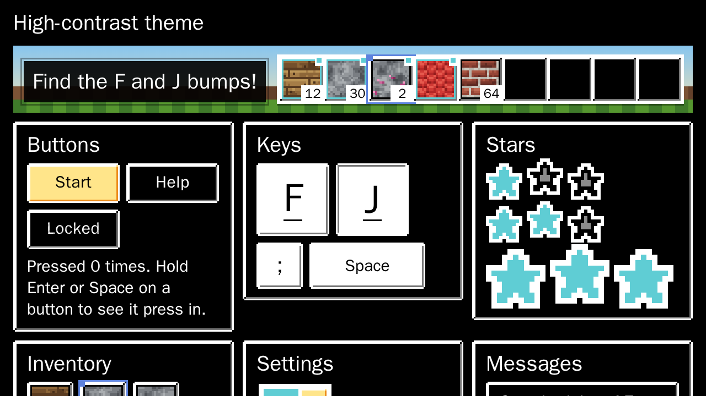 |

These are the 8 baselines the workflow rewrote (it rewrites only pngs that differ). The owner's
playtest shots of the same problem are `docs/screenshots/screenshot-01`, `-02`, `-03`, `-08`,
`-09` and `-11`.

Unrelated to this card, but visible in both map images: the "Pick an island" hint sits on top of
the "Change player" button at 1280×720. It was already there before this change, and the
narrower font doesn't fix it.

- **Review fixes (orchestrator, review on #186):** seven baselines kept Pixelify because the snapshot workflow only rewrites diffs over 1%: `hud-day`, `hud-night`, `hud-contrast`, `lesson-intro`, `map-lesson-path`, `builder-miner` and `builder-sprout`. They were deleted and remade on CI. Settings no longer offers "Blocky": it looked the same as Clear, and its own label was drawn in Pixelify. Saves keep accepting `"pixel"`, which the picker shows as Clear, so the schema is unchanged.

## Acceptance

- [x] Before and after screenshots of each affected screen are in this note (above), and the
      baselines were refreshed through CI (`update-snapshots.yml`).
- [x] Every capital and digit was checked at the sizes the app uses (glyph sheet above).
- [x] No Pixelify weight fixes B and C at button size, so buttons, labels, names and headings use
      `--font-body`. Typing targets were already `--font-body` (decision 68) and are unchanged.
- [x] `npm run verify` passes.

## Decisions

- Pixelify Sans is no longer used for any UI text, big titles included. The glyph sheet shows
  that `B`, `C`, `5`, `0`, `Z` and `J` misread at every weight up to 54 px (the card says to move
  titles too in that case). Priority order: accessibility > visual polish.
- The fix is one token (`--font-pixel: var(--font-body)`), not 25 CSS module edits. It reaches
  every heading, button, label, nameplate, map label, HUD value and the fx float text in one
  place, and a later font choice is also one line.
- The token keeps the name `--font-pixel` so this diff stays small and no module outside the
  card's ownership changes. It now means "UI chrome font". A rename to `--font-ui` can be done
  later.
- `index.html` preloads Atkinson Regular and Bold in place of Pixelify.
- No new font was downloaded or bought.

## New dependencies

- none

## Notes for downstream tasks

- Use `--font-body` for any new text. `--font-pixel` is now an alias for it. Don't point it back at
  Pixelify Sans without a new glyph check.
- Atkinson Hyperlegible ships only weights 400 and 700. Any other weight is synthesized by the
  browser. No current style uses 500 or 600.
- Atkinson is narrower than Pixelify, so buttons and labels got a little shorter, never longer.
  Layouts sized to the text shrink a little (see the after screenshots).

## Contract change request / Questions

- **Contract change request:** `contracts.md` §15 (Save data, `Settings.font`) says `'pixel'` means
  "Pixelify on headings and HUD chrome". It now looks the same as `'clean'`. The type and the save
  schema are unchanged. I propose this comment: `'pixel'`: the default look; `'clean'`: the same
  since M3-FIX-2; `'dyslexic'`: OpenDyslexic everywhere.
- **Question for the owner:** the Settings "Letters" picker still shows three choices, but
  "Blocky" (`pixel`) and "Clear" (`clean`) now look the same in game. Only the option's own label
  is still drawn in Pixelify. Options:
  1. Remove "Blocky" from the picker and migrate saved `pixel` to `clean`. This needs a schema and
     migration change, so it's a separate task.
  2. Keep "Blocky" as an opt-in that puts Pixelify back on big screen titles only, for kids who
     like the look. The default would stay legible.
  3. Leave it as it is.

  I didn't touch `Settings.tsx` or the save schema, because the card doesn't own them.

Closes #152
