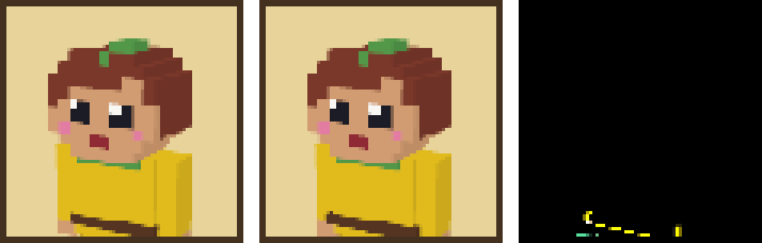

# M3-FIX-5 Avatar onto the model runtime

Status: done

## What changed

- `src/content/cosmetics/base.ts`: the avatar's `VoxelModel` now follows contracts §8.4.
  - The parts are still written as model-space boxes (`min`, `size`, and the joint a part turns
    about), because that is easy to check against the face grid. A small `toModel` turns them into
    §8.4 parts: `pivot` measured from the box's min corner, `offset` from the parent's pivot.
  - A part with no joint of its own (face pixels, hair rows, collar, belt, hands, boots) pivots at
    its min corner and moves with its parent. Every pivot now lies inside or on its own box.
  - The `head` part is now the jaw row, which sits on the neck (`[0, 16, 0]`). The rest of the head
    hangs from it. Before, `head` was the tallest hair block, which doesn't hold the neck point.
  - One model pixel is one face pixel, as before (16 make a block), so the avatar is 26 px tall,
    about 1.6 blocks. `AvatarPreview`'s `BUST` frame (`[10, 27]`, model pixels) still fits.
  - Sizes are now whole pixels (decision 97). Five trims were fractional; see "Look" below.
- `src/render/avatar.ts`: the snapshot builds the model with `buildModel(def, null)`, not with its
  own meshes. `buildModelGroup` and `disposeModelGroup` are gone.
  - `withColors` swaps the skin token for the skin color before the build.
  - `buildModel`'s material is Lambert, so the old baked face shading becomes six directional
    lights, one along each axis, each at intensity `π × shade`. three.js divides diffuse light by
    π, and an axis light reaches only the faces along its own axis, so every face gets exactly its
    old shade (top and front 1, +x 0.8, −x 0.72, back 0.65, bottom 0.55). The lights don't cast
    shadows.
  - `snapshotScene` (exported for tests) returns the scene, the camera and a `dispose`. The camera
    math is unchanged. It now works in world units (`frameY × MODEL_UNIT`, or the built model's
    bounding box).
  - The rest is unchanged: the one shared renderer, the restored render target, clear color,
    alpha and `autoClear`, the context-lost check, the supersampled sRGB read-back.
  - Untouched outside this card: `AvatarPreview` (the per-skin PNG cache and the flat portrait
    fallback) and the IP test in `cosmetics.test.ts`.
- `tests/unit/render/avatar.test.ts`:
  - The scene is built through `buildModel` and nested by parent, with the skin swapped in.
  - The boxes land where M3-09 put them, in model pixels (torso, arm, jaw, hair, leaf, a face
    pixel, the collar's front).
  - The default and bust framing.
  - `withColors` doesn't change the input model.
  - The filled-in avatar passes `modelErrors` apart from the part count.
  - Every size is whole.
  - The lights.
  - The read-back and renderer-restore tests are unchanged.
- `tests/unit/content/cosmetics.test.ts` (the test of `base.ts`, touched because the meaning of
  `offset` changed): the face-front check now adds the neck pivot to the offset.
- `tests/e2e/__screenshots__/profiles.spec.ts/profiles-cards.png`: remade on CI (see Acceptance).

### Look

Only the collar, the belt and the top of the arms show in the profile bust. The rest is below the
frame.

| Part   | Before                           | Now                                               | Shows on the card? |
| ------ | -------------------------------- | ------------------------------------------------- | ------------------ |
| Collar | 6×1×0.5, out 0.5 from the tunic  | 6×1×1, sunk 0.5 into the tunic, so still out 0.5  | Same               |
| Belt   | 8.5×1×4.5 (out 0.25 each side)   | 9×1×5 (out 0.5 each side)                         | A hair wider       |
| Hands  | 1.5 tall                         | 2 tall (y 7–9)                                    | No                 |
| Legs   | 3.5 wide, touching in the middle | 3 wide, 1 px apart, 0.5 in from the tunic's sides | No                 |
| Boots  | 3.75×2×3.75                      | 4×2×4                                             | No                 |

Legs flush with the tunic's sides would drift towards the famous blocky look (IP rule), so they
stay inset and get a gap.

## Acceptance

- [x] The avatar looks the same as before. The baseline was deleted and remade on CI's Linux runner
      (Update snapshots workflow). See the side-by-side in `docs/handoffs/M3-FIX-5/` and the numbers
      below.

Left: the old baseline (M3-09's own mesh code). Middle: the new one (CI run 43347668878).
Right: the difference, ×4. Both are crops of the 76×76 avatar frame, shown at 4× size.

- On the whole 1280×720 page, 36 pixels differ by more than 8/255. All of them are in a 33×8
  strip along the belt (x 204–237, y 375–383): the belt is now 9 wide, not 8.5.
- The face, the hair, the leaf, the collar, the tunic and the shading match pixel for pixel, and
  so does all the text.

- `npm run verify` passes (115 files, 4378 tests, bundle budgets met).

## Decisions

- The avatar keeps 1 model pixel = 1 face pixel. Scaling by 4 would have kept the fractional trims
  exactly, but it would make a 6.5-block-tall avatar and break `BUST`.
- Thin trims become whole-pixel boxes that sink into the box they sit on, so only their outer part
  shows (the collar).
- Face shading comes from six axis lights in the snapshot scene, not from vertex colors, so the
  runtime's geometry and material stay as they are.

## New dependencies

- None.

## Notes for downstream tasks

- The avatar has 50 parts, over `MAX_PARTS` (32), because each run of one color on the face is its
  own box. `buildModel` doesn't check the count; only `parseModel` and `modelErrors` do. The
  avatar isn't a `.model.json`, so nothing validates it at load. If the avatar ever goes into the
  world, or `MAX_PARTS` starts being enforced, the face could become one atlas-textured box.
- The avatar has no anims yet. A walk anim can use the joints: `arm-*` at the shoulders, `leg-*`
  at the hips, `head` at the neck.
- `withColors` and `portraitLights` are exported from `@/render/avatar`, for hats or a dressing
  room later.

## Contract change request / Questions

- (none)

Closes #164
