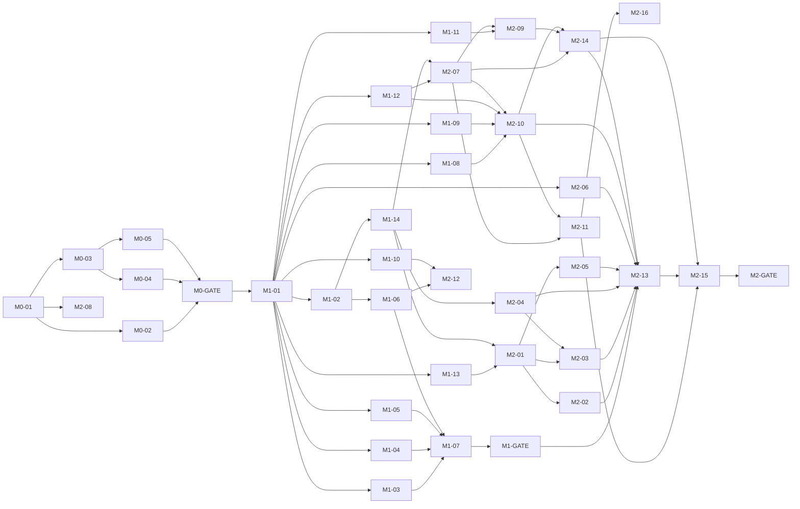

# Task graph, waves and status board

## Scheduling rules

1. A task may start when every task in its **Depends on** list is merged into `main`.
2. **Milestone distance rule:** a task in milestone N may start only after gate **N−2** has passed (so M3 leaf tasks may run while M2 is still being finished; M4 leaf tasks while M3 runs).
3. **⛩ Integration tasks** also require gate **N−1**. They're marked ⛩ below. These are the tasks that wire many modules together and would churn if the previous milestone changed.
4. **M2 is go/no-go.** No M3+ task starts until M2-GATE says **go**, except the content tasks **M3-02** and **M5-05**, which start as soon as M1-10 is merged (owner approved; word lists are useful even if the game design changes).
5. Run at most **3** workers at once (`README.md` §2). When more tasks are ready than slots, pick in this order: critical path first (★), then Tier A before B before C, then larger before smaller.

★ **Critical path:** M0-01 → M0-03 → M0-05 → M0-GATE → M1-01 → M1-02 → M1-14 → M2-01 → M2-03 → M2-13 → M2-15 → M2-GATE → M3-04 → M3-14 → M3-GATE → M4-04 → M4-10 → M4-GATE → M5-01/M5-02 → M5-11 → M5-GATE → M6-03 → M6-10 → M6-09 → release.

## M0–M2 dependency graph

## Suggested waves

Waves are a schedule hint. The real rule is "dependencies merged" plus rules 2–4 above.

| Wave | Tasks (★ = critical path) | Notes |
|---|---|---|
| W0 | ★M0-01 | Solo |
| W1 | ★M0-03, M0-02 | CI first: every later PR depends on it |
| W1b | ★M0-05, M0-04 | Then M0-GATE |
| W2 | ★M1-01 | Solo; freezes contracts |
| W3 | ★M1-02, M1-03, M1-13, M1-04, M1-05, M1-12, M1-09, M1-10, M1-08, M1-11, M2-06, M2-08 | 12 ready tasks; run 3 at a time in this order |
| W4 | ★M1-14, M1-06 | |
| W5 | M1-07, ★M2-01, M2-04, M2-07, M2-12, M3-02 | M1-GATE after M1-07. From here on, M3-02 and then M5-05 fill any free slot (rule 4) |
| W6 | ★M2-03, M2-02, M2-05, M2-09, M2-10 | |
| W7 | M2-11, M2-14 | |
| W8 | ★⛩M2-13, M2-16 | M2-13 is the biggest single task |
| W9 | ★⛩M2-15 | Then **M2-GATE (go/no-go)** |
| W10 | M3-01, ★M3-04, M3-05, M3-07, M3-09, M3-10 · M4-01, M4-06, M4-09 | M4 leaf tasks allowed (rule 2) |
| W11 | M3-03, M3-08 · M4-02, M4-05 | |
| W12 | M3-06, M3-11, M3-12 · M4-03 | |
| W13 | M3-13, ★⛩M3-14 | Then M3-GATE |
| W14 | ★⛩M4-04, ⛩M4-07 · M5-03, M5-07 | M5 leaf tasks allowed |
| W15 | M4-08 · M5-06 | |
| W16 | ★⛩M4-10 | Then M4-GATE |
| W17 | ★⛩M5-01, ★⛩M5-02, M5-09, M5-10 | |
| W18 | M5-04, M5-08 | |
| W19 | ★⛩M5-11 | Then M5-GATE |
| W20 | M6-01, M6-02, ★M6-03, M6-04, M6-05, M6-07, M6-08 | M6-02 and M6-03 touch render files: don't run them at the same time |
| W21 | M6-06, ★M6-10 | |
| W22 | ★M6-09 | Then M6-GATE → `v1.0.0` |

## Status board

The orchestrator updates the **Status** column (`todo` · `ready` · `running (worker id)` · `review` · `merged` · `blocked: reason`). `docs/progress.md` mirrors this at milestone granularity.

✦ = assigned to Fable 5.2 (`README.md` §2). Every other card runs on Opus 5.5.

| ID | Title | Size/Tier | Depends on | Status |
|---|---|---|---|---|
| M0-01 | Toolchain scaffold | M/B | — | todo |
| M0-02 | Docs, agent conventions, copy lint | S/C | M0-01 | todo |
| M0-03 | CI: test everything on every PR | M/B | M0-01 | todo |
| M0-04 | Hello voxel | S/B | M0-01, M0-03 | todo |
| M0-05 | Container image + Proxmox deploy | M/B | M0-01, M0-03 | todo |
| M0-GATE | Gate | — | M0-02..05 | todo |
| M1-01 | ✦ Contracts into code | M/A | M0-GATE | todo |
| M1-02 | Seeded RNG | S/B | M1-01 | todo |
| M1-03 | ✦ Typing session and matcher | L/A | M1-01 | todo |
| M1-04 | Stats, stars, key-stat folding | M/B | M1-01 | todo |
| M1-05 | Adaptive engine | M/A | M1-01 | todo |
| M1-06 | Content generator | M/B | M1-01, M1-02 | todo |
| M1-07 | Replay harness and simulator | M/B | M1-03..06 | todo |
| M1-08 | Input normalization | S/B | M1-01 | todo |
| M1-09 | Save layer | M/B | M1-01 | todo |
| M1-10 | Word-list pipeline | M/B | M1-01 | todo |
| M1-11 | Keyboard layouts | S/C | M1-01 | todo |
| M1-12 | i18n runtime | S/B | M1-01 | todo |
| M1-13 | Voxel grid and mesher | M/A | M1-01 | todo |
| M1-14 | Palette, recipes, atlas | M/A | M1-01, M1-02 | todo |
| M1-GATE | Gate | — | all M1 | todo |
| M2-01 | Render core | M/A | M1-13, M1-14 | todo |
| M2-02 | Sky, clouds, day/night | M/A | M2-01 | todo |
| M2-03 | Meadow diorama | M/A | M2-01, M2-04 | todo |
| M2-04 | Block registry v1 + loot | M/B | M1-14 | todo |
| M2-05 | FX | M/A | M2-01 | todo |
| M2-06 | Audio synth and SFX | M/A | M1-01 | todo |
| M2-07 | Voxel UI kit | M/A | M0-01, M1-12, M1-14 | todo |
| M2-08 | Fonts and typography | S/B | M0-01 | todo |
| M2-09 | On-screen keyboard + hands | M/B | M1-11, M2-07 | todo |
| M2-10 | App shell, routing, hooks | M/A | M1-08, M1-09, M1-12, M2-07 | todo |
| M2-11 | Screens v1 | M/B | M2-07, M2-10 | todo |
| M2-12 | Meadow lessons 1–6 | S/A | M1-06, M1-10 | todo |
| M2-13 | ✦ ⛩ Mine mode | L/A | M1-GATE, M2-02..06, M2-10, M2-14 | todo |
| M2-14 | HUD | M/B | M2-07, M2-09, M2-10 | todo |
| M2-15 | ⛩ Slice E2E + baselines | M/B | M2-11, M2-13, M2-14 | todo |
| M2-16 | Playtest kit | S/C | M2-11 | todo |
| M2-GATE | **Go/no-go** | — | all M2 | todo |
| M3-01 | Curriculum validator + doc gen | S/B | M1-06, M2-12 | todo |
| M3-02 | Word lists biomes 1–4 | L/A | M1-10 | todo |
| M3-03 | Lessons biomes 1–4 | M/A | M3-01, M3-02, M2-12 | todo |
| M3-04 | ✦ World map | L/A | M2-01, M2-03, M2-11 | todo |
| M3-05 | Placement test | M/B | M2-13 | todo |
| M3-06 | Remedial + recommendations | M/B | M1-05, M3-03 | todo |
| M3-07 | Accessibility features | M/B | M2-07, M2-08, M2-09, M2-14 | todo |
| M3-08 | Settings + parent gate | M/B | M2-11, M3-07 | todo |
| M3-09 | Profiles + avatar | M/B | M2-11, M1-09 | todo |
| M3-10 | Achievements v1 | M/B | M2-10 | todo |
| M3-11 | Parent Dashboard v1 | L/B | M3-08, M1-04 | todo |
| M3-12 | Migrations + import/export UI | S/B | M1-09, M3-08 | todo |
| M3-13 | Progression sim study | M/A | M1-07, M3-03, M3-05, M3-06 | todo |
| M3-14 | ⛩ E2E + a11y sweep | M/B | M3-04, M3-05, M3-08..12 | todo |
| M3-GATE | Gate | — | all M3 | todo |
| M4-01 | Voxel model runtime | M/A | M2-01, M1-14 | todo |
| M4-02 | Model Lab | S/C | M4-01 | todo |
| M4-03 | ✦ Mobs wave 1 | L/A | M4-01, M4-02 | todo |
| M4-04 | ✦ ⛩ Night Defense mode | L/A | M4-03, M4-05, M2-13, M2-02, M3-03 | todo |
| M4-05 | Wave director | M/A | M1-04, M1-06, M1-07 | todo |
| M4-06 | Island data + persistence | S/B | M1-09, M1-13 | todo |
| M4-07 | ✦ ⛩ Builder mode | L/A | M4-06, M2-13, M2-14 | todo |
| M4-08 | Blueprints, expansion, snapshot | M/B | M4-07 | todo |
| M4-09 | Inventory screen | M/B | M2-07, M2-04 | todo |
| M4-10 | ⛩ No-failure invariants + E2E | M/B | M4-04, M4-07, M4-08, M4-09 | todo |
| M4-GATE | Gate | — | all M4 | todo |
| M5-01 | ✦ ⛩ Minecart Run | L/A | M2-13, M4-01 | todo |
| M5-02 | ⛩ Boss framework + DSL | M/A | M4-01, M4-04, M2-13 | todo |
| M5-03 | ✦ Boss designs + models | L/A | M4-01, M4-02 | todo |
| M5-04 | Boss scripts | M/B | M5-02, M5-03, M5-06 | todo |
| M5-05 | Content biomes 5–9 | L/A | M1-10, M3-02 | todo |
| M5-06 | Lessons biomes 5–9 | M/A | M5-05, M3-01 | todo |
| M5-07 | ✦ Biomes 5–9 art + mobs wave 2 | L/A | M2-02, M2-03, M4-03 | todo |
| M5-08 | Daily Quest + torches | M/B | M2-13, M4-04, M5-01, M4-07 | todo |
| M5-09 | Free Practice + custom lists | M/B | M2-13, M1-10 | todo |
| M5-10 | Achievements, cosmetics, pets | M/B | M3-10, M4-01, M3-09 | todo |
| M5-11 | ⛩ M5 E2E | M/B | M5-01, M5-04, M5-06..10 | todo |
| M5-GATE | Gate | — | all M5 | todo |
| M6-01 | Procedural music | M/A | M2-06, M5-07 | todo |
| M6-02 | Juice pass | M/A | M5-GATE | todo |
| M6-03 | Quality scaler + perf | M/A | M5-GATE | todo |
| M6-04 | Lite 2D mode | L/B | M5-GATE | todo |
| M6-05 | PWA | M/B | M5-GATE | todo |
| M6-06 | CSP + no-network | S/B | M6-05 | todo |
| M6-07 | Pseudo-locale | S/C | M1-12, M5-GATE | todo |
| M6-08 | Content review pack 👤 | M/A | M5-GATE | todo |
| M6-09 | Docs, release, hosting | M/C | M6-01..08, M6-10 | todo |
| M6-10 | Perf/budget CI | M/B | M6-03, M6-04, M6-05 | todo |
| M6-11 | Deferred: classroom report | — | M6-GATE | deferred |
| M6-GATE | Release | — | all M6 | todo |

**Totals:** 88 rows: 80 tasks (15 S, 52 M, 13 L), 7 gates and the stretch bucket. Rough effort by size (S ≈ 1, M ≈ 3, L ≈ 6 units): about 250 units. With 3 workers the wall-clock is set by the critical path, roughly 55–65% of the serial total.
